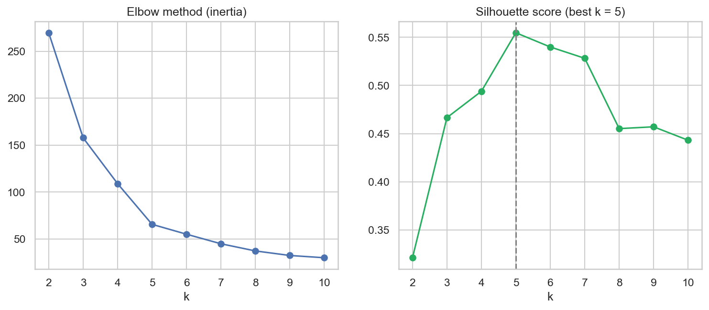

<p align="center"></p>
<p align="center"><a href="https://github.com/khnbutt118-dev">← PROFILE</a> &nbsp;·&nbsp; <a href="https://hassanbuttportfolio.vercel.app/">PORTFOLIO</a> &nbsp;·&nbsp; <a href="https://www.linkedin.com/in/hassan-butt-ab0036334/">LINKEDIN</a></p>

<p align="center"></p>

# 🧩 Customer Segmentation · K-Means
**Discover customer groups from annual income and spending behaviour.**

<table><tr><td align="center"><h2>200</h2><sub>Customers</sub></td><td align="center"><h2>5</h2><sub>Clusters selected</sub></td><td align="center"><h2>0.55</h2><sub>Silhouette score</sub></td><td align="center"><h2>81</h2><sub>Largest segment</sub></td></tr></table>

## 🗺️ Cluster visual gallery
<p align="center"></p>
<p align="center"></p>
<p align="center"></p>

## 👥 Segment insights
<table>
<tr><td width="50%">🏷️ **Average customers**<br><sub>Largest group · 81 customers</sub></td><td width="50%">💎 **Premium segment**<br><sub>39 customers · high income and high spending · average age 33</sub></td></tr>
<tr><td>🎯 **High income, low spending**<br><sub>35 customers · potential audience for targeted campaigns</sub></td><td>📐 **Cluster selection**<br><sub>k = 5 selected using elbow and silhouette analysis</sub></td></tr>
</table>

## ⚙️ Workflow
Feature preparation → Elbow & silhouette analysis → K-Means clustering → Segment profiling → Visual interpretation

## ▶️ Reproduce
```bash
pip install -r requirements.txt
python main.py
```

<details><summary><b>Dataset & outputs</b></summary>

- Dataset: [Mall Customer Segmentation](https://www.kaggle.com/datasets/vjchoudhary7/customer-segmentation-tutorial-in-python)
- Data used: 200 rows × 5 columns
- Outputs: `segment_profiles.csv`, `customers_with_segments.csv`, `outputs/`

</details>
<p align="center"><sub>Python · Pandas · Scikit-learn · K-Means</sub></p>
