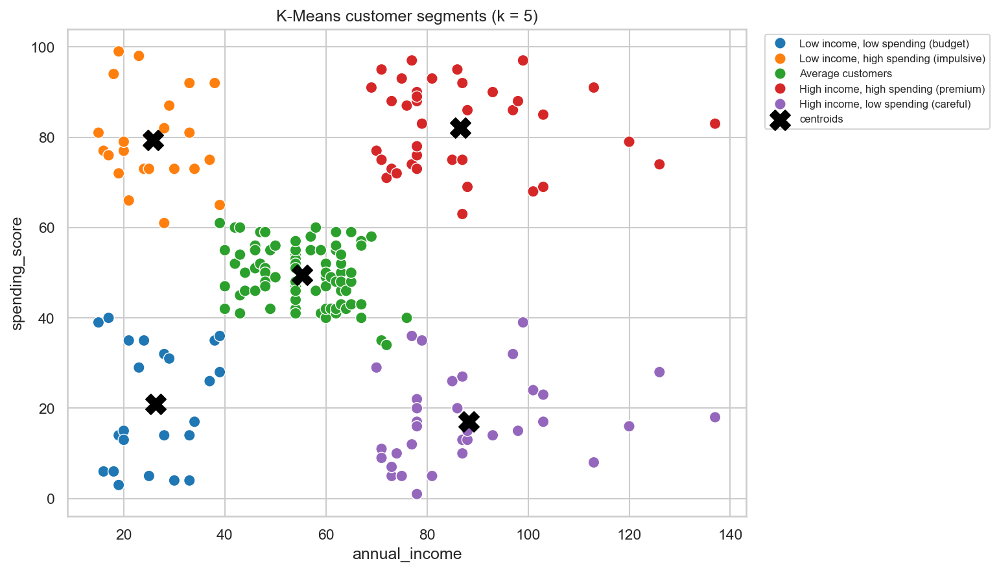
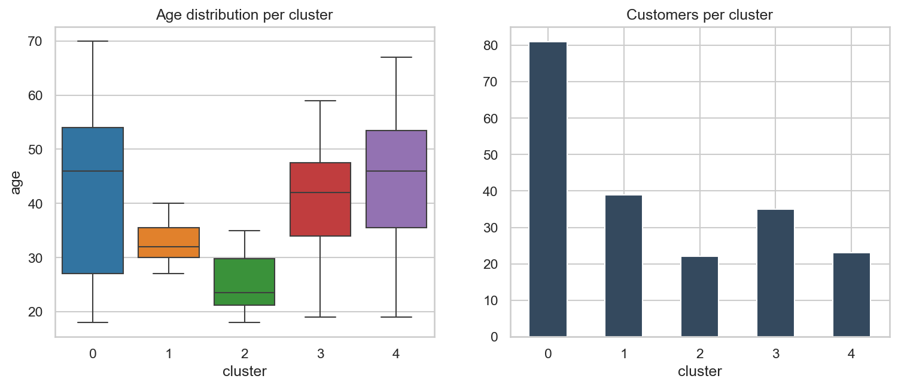

# Customer Segmentation (Mall Customers, K-Means)

> Synent Technologies Data Science Internship | Task 6 (Intermediate level) | Author: Hassan Butt

## Problem statement
Group mall customers by income and spending behaviour so marketing can target each segment.

## Dataset details
- **Dataset:** Mall Customer Segmentation dataset
- **Source:** https://www.kaggle.com/datasets/vjchoudhary7/customer-segmentation-tutorial-in-python
- **Size used:** 200 rows x 5 columns

## Approach
1. Cleaned and standardised the features
2. Chose k with the elbow method and silhouette score
3. Fitted K-Means and profiled each cluster (age, income, spending)
4. Named the segments and visualised clusters with centroids

## Results
| Metric | Value |
|---|---|
| Customers | 200 |
| Clusters (k) | 5 |
| Silhouette score | 0.55 |
| Largest segment | Average customers |

**Key insights**

- The silhouette score is highest at k = 5 (0.55), so 5 segments were used.
- The largest segment is 'Average customers' with 81 customers.
- The premium segment (high income, high spending) has 39 customers with an average age of 33, a priority for loyalty offers.
- The 'high income, low spending' segment (35 customers) is a candidate for targeted campaigns, since these customers have the means to spend more.

**Figures**





**Other output files:** `segment_profiles.csv`, `customers_with_segments.csv`

## How to run
```bash
pip install -r requirements.txt
python main.py
```

## Project structure
```
main.py            # full analysis / pipeline
requirements.txt
data/              # dataset (see data/README.md)
outputs/           # figures, tables and reports
```

## Academic integrity
All analysis code and write-ups in this repository were written by the author. The dataset belongs to its original creators (see link above).
